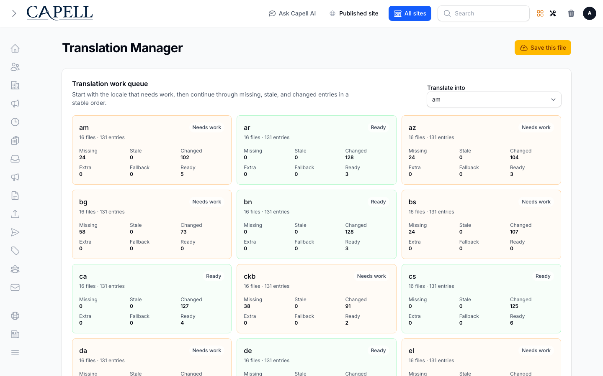

# Translation Manager

<!-- prettier-ignore-start -->

Button labels, form messages and menu text can be translated from one admin page, side by side with the original wording. This wording lives in language files, and the page edits them for you. Open Translations in the System menu and pick a language to see what is missing and what has gone out of date because the original wording was edited.

It covers the wording built into the system, your theme and installed packages. Page content is translated on each page's language tabs. The view permission opens the page, and changes need the manage permission.

Because changes are written to your language files, the server needs a language folder it can write to and that is kept when the site is updated. A queue worker, a program on the server that handles background jobs, runs the readiness check.

Wording from packages is saved as your own copy, so a package update doesn't overwrite it. Saving checks that placeholders, plural forms and any glossary terms you have set still match the original. You can create a language, duplicate one, or export CSV, PO and XLIFF files for an outside translator and paste the translated file back in. Publish readiness marks each language as ready or not and shows how many entries are still missing or out of date.

- **Price and availability:** Check current availability and price on the [Capell Marketplace listing](https://capell.app/marketplace/extensions/translation-manager).
- **Licence:** Check the licence terms on the [Capell Marketplace listing](https://capell.app/marketplace/extensions/translation-manager).
- **Requires:** `PHP ^8.4`, `capell-app/admin ^1.0.78`, `capell-app/core ^1.0.75`, `lorisleiva/laravel-actions ^2.8`, `spatie/laravel-data ^4.5`, `spatie/laravel-package-tools ^1.14.1`.
- **Install:** `composer require capell-app/translation-manager:@beta`.

## Quick Start

1. Install the package: `composer require capell-app/translation-manager:@beta`.
2. Open the package admin surface at `/admin/translation-manager` and confirm Translation Manager is available.

## For Developers

A TranslationFileStore contract separates file access from focused comparison and write Actions, so storage behaviour remains testable.

## Configure

- **Configuration files:** `config/capell-translation-manager.php`.

## Limits And Pitfalls

- Install the required Capell packages at the versions in `composer.json`: `capell-app/admin ^1.0.78`, `capell-app/core ^1.0.75`.
- Run migrations before opening package resources or public routes.

## Screens And Workflow

- Translation Manager work queue (admin).
- Translation comparison in the installed Translation Manager (admin).
- Create locale modal (admin).
- Duplicate locale modal (admin).
- Translate a selected missing entry (admin).
- Changed and missing translations in the native review grid (admin).
- Import translations modal (admin).
- Review and accept a translation suggestion (admin).
- Locale publish readiness (admin).

## Install Impact

- Required packages: `capell-app/admin`, `capell-app/core`.
- Admin navigation: declares `admin-page: TranslationManagerPageContribution`; each Filament page or resource controls its own navigation visibility.
- Admin/editor extensions: none declared.
- Permissions: `View:TranslationManagerPage`, `Manage:TranslationManagerPage`.
- Public routes: none declared.
- Database changes: package migrations are declared.
- Config: `config/capell-translation-manager.php`.
- Settings: no package settings declared.
- Queues or schedules: queue jobs `RunTranslationScanJob`.
- Cache tags: none declared.
- Commands: none declared.

## Troubleshooting

| Symptom | Likely cause | Check | Fix |
| --- | --- | --- | --- |
| Package surface is missing after install | Provider or manifest is not loaded | Confirm `capell.json`, package `composer.json`, and provider registration | Reinstall the package, refresh Composer autoload, and clear host caches |
| Admin screen or command fails on missing table | Package migrations have not run | Check the tables listed in `Data Model` | Run host migrations and rerun the focused package test |
| Background work does not run | Queue worker or declared schedule is not active | Check the jobs and scheduled commands listed in `Technical Shape` | Start the queue worker or host scheduler, then run the focused command or package test |

## Upgrading

No manual steps between minor versions.

Read [CHANGELOG.md](CHANGELOG.md) before upgrading.

## Next Steps

- [Package docs](docs/README.md)
- [Overview](docs/overview.md)
- [Worked extension examples](docs/extension-contracts.md)
- [Admin guide](docs/admin-guide.md)
- Configuration files: [`config/capell-translation-manager.php`](config/capell-translation-manager.php).
- [Troubleshooting](#troubleshooting)
- [Developer reference](docs/reference.md)
- [Marketplace assets](docs/assets/marketplace/)
- [Capell content language plan](../../docs/CONTENT_LANGUAGE_PLAN.md)
- [Capell documentation design system](../../docs/DESIGN_SYSTEM.md)
- [Capell and package ERD notes](../../docs/erd/capell-and-package-erds.md)
- Related packages: [AI Orchestrator](../ai-orchestrator/README.md).

<!-- prettier-ignore-end -->
